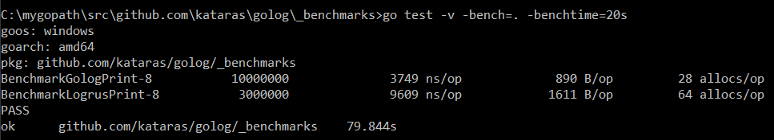

# Running the benchmarks

This directory is its own module, with a `replace` pointing at the checkout one
level up, so it always measures the working tree.

```bash
$ cd _benchmarks
$ go test -run xxx -bench . -benchmem -count=3
```

# Results

Each operation writes three log lines (error, warning, info) to a nop output,
except `BenchmarkGologPrintFile`, which writes them to a real file so that the
syscalls count too.

| test | ns/op (small is better) | B/op (small is better) | allocs/op (small is better) |
| ----------- | ------------- | ------------- | ------------- |
| **BenchmarkGologPrint** | 923 ns/op | 154 B/op | 5 allocs/op |
| **BenchmarkGologPrintJSON** | 2805 ns/op | 148 B/op | 5 allocs/op |
| **BenchmarkGologPrintFile** | 9067 ns/op | 139 B/op | 5 allocs/op |
| BenchmarkLogrusPrint | 7243 ns/op | 1742 B/op | 54 allocs/op |
| BenchmarkStdPrint | 1130 ns/op | 72 B/op | 5 allocs/op |

`BenchmarkStdPrint` is the standard library's `log`, which has no levels, no
fields and no formatter to run: it is the floor, not a competitor. The
benchmarks are built in CI but not run there; timings from a shared runner are
noise.

> Feel free to send a [PR](https://github.com/kataras/golog/pulls) of your own logger benchmark to put it here!

<details>
<summary>Details</summary>

Date: Fri 11 Sep 2026

go1.27.0, windows/amd64, AMD Ryzen AI 9 465.

The 2017 numbers this table replaces (3749 ns/op and 28 allocs/op for golog,
9609 ns/op and 64 allocs/op for logrus, on an i7-4710HQ) are kept in git
history with the screenshot below.


</details>
